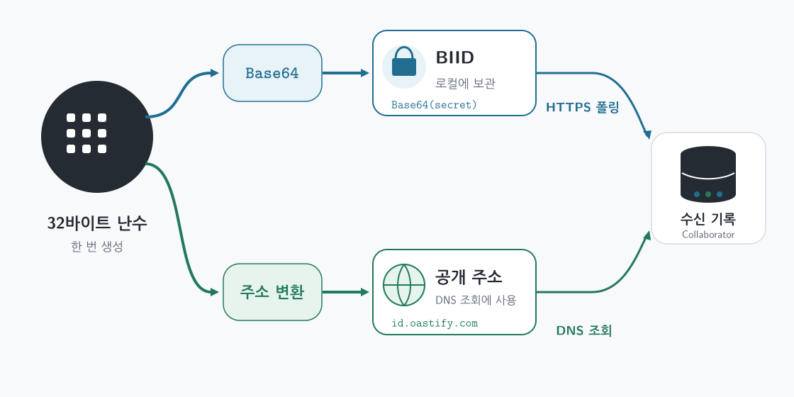
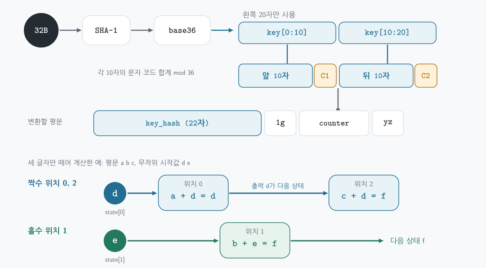

# Burp Collaborator 공개 서버용 CLI 클라이언트 구현

웹 응답에 결과가 드러나지 않는 테스트에서는 대상이 외부로 보낸 DNS 조회를 관찰할 수 있다. Burp Collaborator 공개 서버는 고유한 하위 도메인으로 들어온 조회를 기록한다. 클라이언트는 그 주소를 만들고, 나중에 자신만 가진 비밀값으로 기록을 가져온다. 이 글은 **주소 생성 → DNS 조회 확인 → 수신 기록 저장**까지의 CLI 구현을 설명한다.

아래 Python 구현은 비공식 [OAST-Community 클라이언트](https://github.com/Groppoxx/OAST-Community)의 주소 생성 방식을 참고했다. **공식 SDK나 고정된 공개 API의 명세가 아니다.** 공개 서버의 형식이 바뀌면 자체 DNS 조회와 폴링으로 다시 확인해야 한다. PortSwigger는 비밀값에서 파생한 식별자를 요청에 사용하고, 비밀값은 HTTPS 조회에만 사용한다고 설명한다. [PortSwigger — Collaborator data security](https://portswigger.net/burp/documentation/collaborator/server/security)

## 먼저 구분할 것: 주소와 BIID



처음에 만든 **32바이트 난수 하나**에서 두 값이 나온다.

- **BIID:** 난수를 Base64 문자열로 표현한 값이다. Base64는 암호화가 아니므로 BIID를 비밀로 보관한다. 수신 기록을 읽을 때 HTTPS 폴링 요청의 `biid` 매개변수로 보낸다.
- **공개 호스트 이름:** 같은 난수에서 여러 변환을 거쳐 만든 `식별자.oastify.com`이다. DNS 조회를 받을 주소이므로 외부에 드러나도 된다. 주소 문자열에 BIID를 직접 넣지 않는다.

이 둘을 연결해 주는 쪽은 Collaborator 서버다. 누군가 공개 주소를 조회하면 서버가 상호작용을 기록하고, 클라이언트는 해당 BIID로 그 기록을 읽는다. 주소만으로 기록을 조회할 수는 없다. [PortSwigger — Collaborator data security](https://portswigger.net/burp/documentation/collaborator/server/security)

## 공개 주소를 만드는 다섯 단계



1. **키 20자:** 원본 난수의 SHA-1 다이제스트를 부호 없는 정수로 읽고 `abcdefghijklmnopqrstuvwxyz0123456789` 순서의 36진 문자열로 바꾼다. 앞을 `a`로 채워 최소 20자로 만든 뒤 왼쪽 20자를 취한다.
2. **검사 문자 두 개:** 키를 10자씩 나눈다. 각 조각의 문자 코드값(`ord`)을 모두 더하고 36으로 나눈 나머지를 알파벳의 인덱스로 사용한다. 각 조각 뒤에 검사 문자 하나씩 붙여 총 22자가 된다. 작은 예로 `a`, `b`의 코드값은 97, 98이므로 `(97 + 98) % 36 = 15`, `alphabet[15]`는 `p`다. 실제 계산 대상은 각 **10자 조각**이다.
3. **형식 문자열:** 22자 뒤에 `1g`, 16진수 카운터, `yz`를 붙인다. 카운터를 `0`, `1`, `2`로 올리면 같은 BIID에 연결되는 새 주소를 만들 수 있다.
4. **위치별 변환:** 무작위 문자 두 개를 뽑아 두 상태 레지스터의 초기값으로 쓴다. 평문의 짝수 위치는 첫째, 홀수 위치는 둘째 레지스터와 36진 인덱스를 더한다. 출력 문자를 해당 레지스터의 다음 상태로 바꾼다. 마지막에 이 두 난수 문자와 그 검사 문자를 변환 결과 앞에 붙인다. 여기서 검사 문자는 형식 검사값이지 비밀키가 아니다.
5. **도메인 연결:** 완성된 식별자에 `.oastify.com`을 붙인다. 이 주소로 DNS 조회가 일어나면 서버에서 상호작용을 확인할 수 있다.

네 번째 단계의 상태 갱신이 낯설다면 세 글자만 손으로 계산해 볼 수 있다. 아래는 **실제 주소 형식이 아닌 계산 예시**다. `a=0`, `b=1`, …인 36진 알파벳에서 초기 상태를 `d`, `e`, 평문을 `abc`로 둔다.

| 위치 | 입력 | 사용한 상태 | 계산 | 출력 및 다음 상태 |
| --- | --- | --- | --- | --- |
| 0 | `a`(0) | 첫째 `d`(3) | `(0 + 3) % 36` | `d`; 첫째 상태가 `d` |
| 1 | `b`(1) | 둘째 `e`(4) | `(1 + 4) % 36` | `f`; 둘째 상태가 `f` |
| 2 | `c`(2) | 첫째 `d`(3) | `(2 + 3) % 36` | `f`; 첫째 상태가 `f` |

첫째 상태는 위치 0과 2에서, 둘째 상태는 위치 1에서 사용된다. 코드의 `state[index % 2] = output`이 바로 이 갱신이다. 두 난수 문자 때문에 같은 평문이라도 주소의 겉모습은 달라질 수 있다.

## Python으로 주소 생성하기

위 다섯 단계를 그대로 옮기면 다음과 같다. `check_char`는 **알파벳 인덱스의 합**이 아니라 **문자 코드값의 합**을 쓴다. 아래 예제는 BIID를 출력하지 않는다.

```python
import base64
import hashlib
import secrets

ALPHABET = "abcdefghijklmnopqrstuvwxyz0123456789"

def base36(number):
    digits = []
    while number:
        number, remainder = divmod(number, 36)
        digits.append(ALPHABET[remainder])
    return "".join(reversed(digits)) or "a"

def check_char(value):
    return ALPHABET[sum(ord(char) for char in value) % 36]

def make_hostname(secret, counter=0):
    digest = hashlib.sha1(secret).digest()
    key = base36(int.from_bytes(digest, "big")).rjust(20, "a")[:20]
    key_hash = (
        key[:10] + check_char(key[:10])
        + key[10:] + check_char(key[10:])
    )
    plaintext = f"{key_hash}1g{counter:x}yz"

    salt = [secrets.choice(ALPHABET), secrets.choice(ALPHABET)]
    state = salt.copy()
    encrypted = []
    for index, char in enumerate(plaintext):
        register = index % 2
        value = (ALPHABET.index(char) + ALPHABET.index(state[register])) % 36
        output = ALPHABET[value]
        encrypted.append(output)
        state[register] = output

    identifier = "".join(salt) + check_char("".join(salt)) + "".join(encrypted)
    return f"{identifier}.oastify.com"

secret = secrets.token_bytes(32)
biid = base64.b64encode(secret).decode("ascii")
hostname = make_hostname(secret, counter=0)
print(hostname)  # BIID는 출력하지 않는다.
```

`make_hostname(secret, 0)`이 만든 첫 주소로 자체 조회를 한 다음 `make_hostname(secret, 1)`을 만들 수 있다. 실제 CLI는 실행을 나눠도 주소를 다시 읽을 수 있도록 **BIID, 다음 카운터, 이미 만든 주소**를 로컬 상태 파일에 저장한다.

## DNS 조회와 폴링으로 검증하기

먼저 **내 컴퓨터에서** 생성한 이름을 DNS로 조회한다. 이어서 공개 서버의 폴링 주소에 BIID를 URL 인코딩해 보낸다. 아래 코드는 두 동작의 최소 예시다. 전체 CLI에서는 폴링 응답의 `responses`를 **먼저 파일에 저장하고**, 그다음 요약을 출력한다. 읽은 이벤트가 다음 폴링에서 다시 돌아오지 않을 수 있기 때문이다. [OAST-Community — Persistent Interaction History](https://github.com/Groppoxx/OAST-Community#persistent-interaction-history)

```python
import json
import socket
import urllib.parse
import urllib.request

socket.getaddrinfo(hostname, 80)  # 내가 만든 주소로 자체 DNS 조회

query = urllib.parse.urlencode({"biid": biid})
request = urllib.request.Request(
    f"https://polling.oastify.com/burpresults?{query}",
    headers={"Accept": "application/json"},
)
with urllib.request.urlopen(request, timeout=20) as response:
    interactions = json.load(response).get("responses", [])

for item in interactions:
    print(item.get("protocol"), item.get("data", {}).get("subDomain"))
```

DNS 이벤트의 `protocol`은 `dns`, `data.subDomain`은 실제로 조회된 호스트 이름이다. `A`와 `AAAA` 조회나 여러 리졸버 때문에 같은 주소가 여러 이벤트로 나타날 수 있다. 자체 조회 뒤 같은 BIID로 폴링한 시험에서는 **DNS 이벤트 4건**이 수신되었다. 이는 주소 생성과 조회의 연결이 작동한다는 확인이며, 다른 시스템에서 조회가 발생했다는 뜻은 아니다.

처음에는 검사 문자를 `alphabet.index(char)`의 합계로 계산했다. DNS 이름은 해석됐지만 해당 BIID의 폴링 결과가 비어 있었다. `sum(ord(char) for char in value)`로 고친 뒤 자체 조회 이벤트가 반환되었다. **DNS 해석 성공과 BIID로 이벤트 조회 성공을 각각 확인해야 한다.**

## 로컬 상태 관리

CLI를 여러 번 실행한다면 BIID, 다음 카운터, 만든 주소 목록을 사용자만 읽을 수 있는 로컬 상태 파일에 저장한다. 폴링 결과는 받은 직후 별도 로그에 기록한다. BIID가 담긴 상태 파일은 Git에 커밋하거나 화면에 출력하지 않는다. `*.oastify.com`과 `polling.oastify.com`은 여기서 검증한 공개 서버 조합이며, 제공 도메인은 바뀔 수 있다. [PortSwigger — Getting started with Burp Collaborator](https://portswigger.net/burp/documentation/desktop/tools/collaborator/getting-started)

## 참고 구현의 라이선스

주소 생성 코드의 기준이 된 [OAST-Community](https://github.com/Groppoxx/OAST-Community)는 MIT 라이선스로 배포된다. 저작권 및 허가 고지는 다음과 같다.

```text
Copyright (c) 2026 Iam Anthony Marcelo Alvarez Orellana

MIT License: Permission is hereby granted, free of charge, to any person
obtaining a copy of this software and associated documentation files (the
"Software"), to deal in the Software without restriction, including without
limitation the rights to use, copy, modify, merge, publish, distribute,
sublicense, and/or sell copies of the Software, and to permit persons to whom
the Software is furnished to do so, subject to the following conditions:

The above copyright notice and this permission notice shall be included in all
copies or substantial portions of the Software.

THE SOFTWARE IS PROVIDED "AS IS", WITHOUT WARRANTY OF ANY KIND, EXPRESS OR
IMPLIED, INCLUDING BUT NOT LIMITED TO THE WARRANTIES OF MERCHANTABILITY,
FITNESS FOR A PARTICULAR PURPOSE AND NONINFRINGEMENT. IN NO EVENT SHALL THE
AUTHORS OR COPYRIGHT HOLDERS BE LIABLE FOR ANY CLAIM, DAMAGES OR OTHER
LIABILITY, WHETHER IN AN ACTION OF CONTRACT, TORT OR OTHERWISE, ARISING FROM,
OUT OF OR IN CONNECTION WITH THE SOFTWARE OR THE USE OR OTHER DEALINGS IN THE
SOFTWARE.
```
