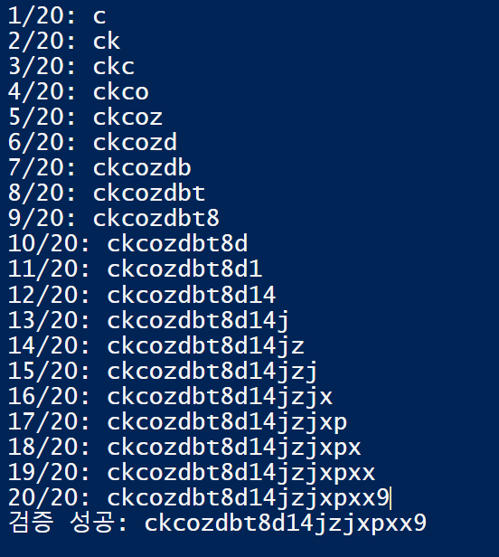

# Blind SQL injection with conditional responses

## 문제 조건과 설명

`TrackingId` 쿠키가 SQL 조회에 들어간다. 결과나 오류는 화면에 나오지 않지만, 조회가 행을 반환하면 `Welcome back!`이 표시된다. 주어진 `users(username, password)` 테이블에서 `administrator`의 비밀번호를 알아내 로그인하는 실습이다.

[PortSwigger 실습](https://portswigger.net/web-security/sql-injection/blind/lab-conditional-responses)

## 탐색 및 풀이 기록

### 초기 관찰

#### 응답 문구를 참·거짓 신호로 확인

`TrackingId`에 `' OR 1=1 -- -`를 넣자 `Welcome back!`이 표시됐다. 이후 원래 쿠키 값 뒤에 조건을 붙여 비교했다. `'1'='1'`일 때는 문구가 나오고 `'1'='2'`일 때는 나오지 않아, 조건의 결과를 이 문구로 구별할 수 있었다.

~~~sql fragment
<원래 TrackingId>' AND '1'='1' -- -
<원래 TrackingId>' AND '1'='2' -- -
~~~

### 실행 과정

#### 비밀번호 길이 확인

`LENGTH(password)`가 특정 숫자와 같은지 차례로 물었다. `administrator`에 대해 **20**일 때 `Welcome back!`이 나와 길이를 확인했다.

~~~sql fragment
<원래 TrackingId>' AND (SELECT LENGTH(password) FROM users WHERE username='administrator')=20 -- -
~~~

#### 문자별 ASCII 이진 탐색

각 위치의 문자에 `ASCII`를 적용하고 중간값보다 큰지 비교했다. 참이면 탐색 범위의 하한을, 거짓이면 상한을 옮겼다. 출력 가능한 ASCII 범위에서 이 과정을 20번 반복해 비밀번호를 얻었다.

~~~sql fragment
<원래 TrackingId>' AND (SELECT ASCII(SUBSTRING(password FROM 5 FOR 1)) FROM users WHERE username='administrator')>115 -- -
~~~

처음 쓴 `SUBSTR(password,5,1)`은 쉼표 때문에 PowerShell의 `CookieContainer.Add()`에서 거부됐다. 이 실습에서는 쉼표가 없는 `SUBSTRING(password FROM 5 FOR 1)` 문법이 동작했다. 이번 인스턴스에서 추출한 값은 `ckcozdbt8d14jzjxpxx9`(20자)였고, 비밀번호 전체를 조건으로 다시 조회해 `검증 성공`을 확인했다.

#### 관리자 로그인

확인한 비밀번호로 로그인하자 계정 화면에 `administrator`가 표시됐다.

## 최종 결과

`Welcome back!` 신호로 20자 비밀번호를 복원하고 전체 값을 검증했다. 그 값으로 로그인해 `administrator` 계정 화면을 확인했다.

## 배운 점

응답 문구가 조건의 참·거짓과 연결되는지 먼저 대조해야 한다. 연결이 확인되면 SQL 결과가 보이지 않아도 길이와 각 문자를 조건문으로 좁힐 수 있다.

## 관련 개념

- [SQL 기초와 SQL 인젝션이 생기는 원리](../../concepts/sql-injection-foundations.md)
