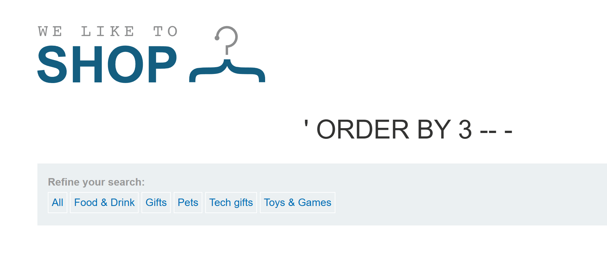
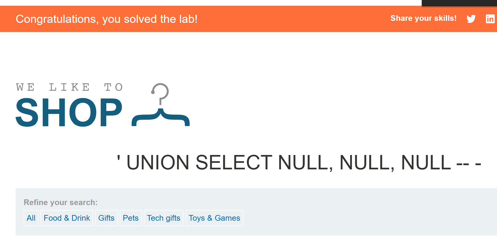

# SQL injection UNION attack, determining the number of columns returned by the query

## 문제 조건과 설명

상품 카테고리 필터의 SQL injection을 이용해 원래 조회의 열 개수를 알아내고, 같은 개수의 `NULL`을 넣은 `UNION SELECT`로 실습을 완료하는 문제다.

[PortSwigger 실습](https://portswigger.net/web-security/sql-injection/union-attacks/lab-determine-number-of-columns)

## 탐색 및 풀이 기록

### 초기 관찰

#### 주입과 열 개수 확인

카테고리에 `' OR 1=1 -- -`를 넣었을 때 여러 카테고리의 상품이 표시돼 주입이 반영되는 것을 확인했다. `ORDER BY`의 번호를 늘려 보니 3은 정상 응답이었고, 4에서 내부 서버 오류가 났다.

~~~sql fragment
' ORDER BY 3 -- -
' ORDER BY 4 -- -
~~~

네 번째 정렬 위치에서 오류가 나므로 반환 열은 **세 개**로 판단했다. 오류의 서버 내부 원인은 확인하지 못했다.

### 실행 과정

#### 세 열로 `UNION SELECT`

열 개수에 맞춰 `NULL` 세 개를 넣었다.

~~~sql fragment
' UNION SELECT NULL, NULL, NULL -- -
~~~

실습 완료 배너가 표시됐다. 따라서 세 열이라는 추측을 실제 `UNION` 요청으로도 확인했다.

## 최종 결과

`ORDER BY 3`은 통과하고 4에서 오류가 난 차이로 열 수를 좁혔다. `UNION SELECT NULL, NULL, NULL`이 성공하면서 원래 조회가 세 열을 반환한다는 사실을 확인했다.

## 배운 점

`ORDER BY`에서 마지막으로 성공한 위치를 찾으면 반환 열 수를 추정할 수 있다. 같은 수의 `NULL`로 `UNION`이 성공하는지 다시 확인했다.

## 관련 개념

- [UNION 기반 SQL 인젝션으로 테이블과 열 찾기](../../concepts/sql-injection-union-workflow.md)
