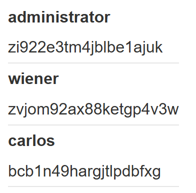
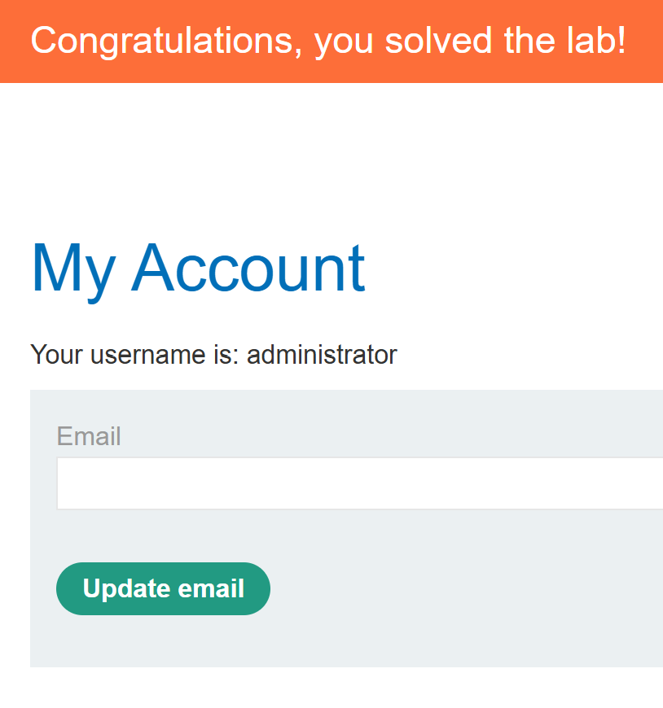

# SQL injection UNION attack, retrieving data from other tables

## 문제

상품 카테고리 필터의 SQL injection으로 별도 `users` 테이블의 계정 정보를 조회하는 실습이다. 테이블 이름 `users`와 열 이름 `username`, `password`는 문제에 주어져 있다. 계정 정보를 확인한 뒤 `administrator`로 로그인해야 한다.

[PortSwigger 실습](https://portswigger.net/web-security/sql-injection/union-attacks/lab-retrieve-data-from-other-tables)

## 풀이 기록

### 1. 열 개수 확인

`ORDER BY`로 원래 상품 조회가 **두 열**을 반환하는 것을 확인했다. 따라서 `UNION SELECT`에도 두 값을 배치했다.

### 2. 계정 행 조회

카테고리 입력에 다음 값을 넣었다.

~~~sql fragment
' UNION SELECT username, password FROM users-- -
~~~

상품 목록에 `administrator`, `wiener`, `carlos`의 사용자 이름과 각 비밀번호가 표시됐다. 두 열의 값이 같은 행에서 짝을 이루므로 관리자 계정의 비밀번호를 식별할 수 있었다.

### 3. 관리자 로그인

조회 결과에서 확인한 `administrator` 계정 정보로 로그인했다. 계정 화면에 관리자 이름과 실습 완료 배너가 표시됐다.

## 정리

이 실습에서는 테이블과 열 이름이 주어졌다. 열 개수를 두 개로 맞춘 뒤 `username`, `password`를 각각 출력해 계정 정보를 확인하고 관리자 로그인까지 완료했다.

## 관련 개념

- [UNION 기반 SQL 인젝션으로 테이블과 열 찾기](../../concepts/sql-injection-union-workflow.md)
