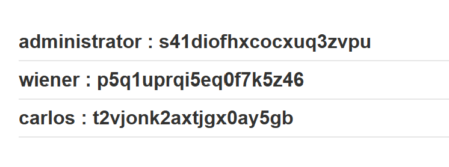
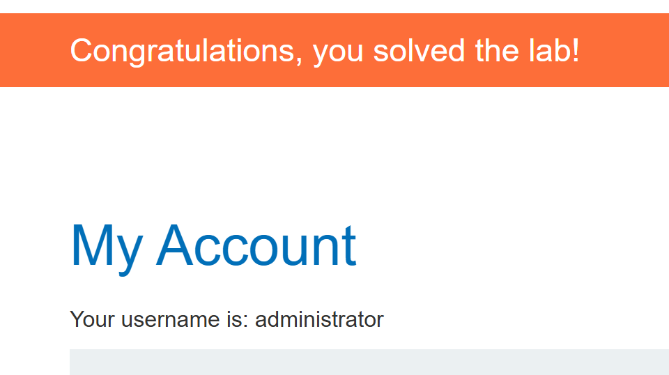

# SQL injection UNION attack, retrieving multiple values in a single column

## 문제 조건과 설명

상품 카테고리 필터에 `UNION`을 주입해 `users` 테이블의 `username`, `password`를 조회하는 실습이다. 결과 화면에서 문자열을 표시할 수 있는 열은 하나이므로 두 값을 그 열에 함께 넣어야 한다. 조회 후 `administrator`로 로그인하면 완료된다.

[PortSwigger 실습](https://portswigger.net/web-security/sql-injection/union-attacks/lab-retrieve-multiple-values-in-single-column)

## 탐색 및 풀이 기록

### 초기 관찰

#### 열 개수와 출력 위치

`ORDER BY`로 원래 조회의 반환 열이 **두 개**임을 확인했다. 첫 번째 열에 문자열을 넣은 `' UNION SELECT 'TEST', NULL -- -`는 내부 서버 오류가 났다. 이 오류만으로 서버 내부 원인을 알 수는 없다.

두 열에 맞추지 않고 값 세 개를 나열한 시도도 오류가 났다. 두 값을 **한 출력 열에 합치는 것**과 `UNION SELECT`의 **열 개수를 늘리는 것**은 다르다.

### 실행 과정

#### 두 값을 두 번째 열에 합쳐 조회

두 번째 출력 열에서 `username`과 `password`가 구분자 ` : `를 사이에 두고 함께 표시됐다. 화면과 같은 형식을 만드는 쿼리는 다음과 같다.

~~~sql fragment
' UNION SELECT NULL, username||' : '||password FROM users-- -
~~~

결과 목록에 `administrator`, `wiener`, `carlos`의 이름과 비밀번호가 각각 한 칸에 짝지어 나타났다.

#### 관리자 로그인

표시된 관리자 계정 정보로 로그인하자 계정 화면에 `administrator`가 나타나고 실습 완료 배너가 떴다.

## 최종 결과

원래 조회의 열은 두 개였고, 필요한 두 값은 두 번째 열 하나에 합쳐 출력했다. 구분자를 넣어 계정별 이름과 비밀번호를 구별한 뒤 관리자 로그인을 완료했다.

## 배운 점

화면에 표시되는 문자열 열이 하나여도 SQL에서 두 값을 이어 붙이면 사용자 이름과 비밀번호의 짝을 확인할 수 있다.

## 관련 개념

- [UNION 기반 SQL 인젝션으로 테이블과 열 찾기](../../concepts/sql-injection-union-workflow.md)
